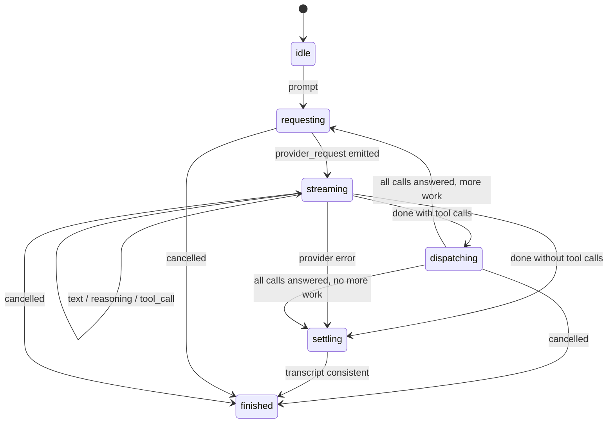

# ADR 0005: The core harness — a pure transition system

- **Status:** Proposed
- **Date:** 2026-11-20
- **Owner:** petr p.b.kosov@yandex.ru
- **Refines:** [ADR 0002](./0002-core-harness.md), [ADR 0003](./0003-core-scope.md) D15–D16, [ADR 0004](./0004-quality-bar.md) D19–D22
- **Research base:** [research 03](../research/03-pi-core-teardown.md) §17

## Context

The concept is now fixed: MiHa is a very small, embeddable harness for a **decentralised
agent** — one that can work on the frontend and hand work to a backend peer, and back.
It is simple, reliable, effective and functional; fast and small; it covers the whole
class of tasks agents do, which is a **loop with tools**; it is functionally at parity
with the established harnesses without being a copy of any of them; and it is built to
be embedded as the agent engine in our own projects.

What is still missing is the thing the concept is actually made of: **the harness
itself**. The earlier decisions fixed the boundary (browser-first, our own core, zero
dependencies, 30 KB ceiling), the laws (ADR 0004 D22), and the discipline (ADR 0003
D16). None of them says how a run actually works.

Two questions decide this design, and they are not the same question:

1. **Where does the work happen?** A harness that performs I/O itself is hard to test,
   hard to reason about, and impossible to run in two places at once (a page and a
   server) without two implementations.
2. **What is the object being designed?** Not "a loop", but a **state machine over a
   small state space**, whose laws are properties of that machine.

This ADR answers both, and then specifies the pieces: the transcript, the tool
contract, the dispatch policy, the run states, the exchange with a peer, and the
optional interface layer.

## Decision

### D24. The core performs no I/O; it emits intents

The harness is a **pure transition function**. It never calls a provider, never runs a
tool, never touches a clock. It consumes an input and produces a state plus a list of
**intents** — requests for the host to perform.

```ts
export type Input =
  | { readonly kind: "prompt"; readonly message: UserMessage }
  | { readonly kind: "steer"; readonly message: UserMessage }
  | { readonly kind: "provider"; readonly event: ProviderEvent }
  | { readonly kind: "tool_result"; readonly result: ToolResultMessage }
  | { readonly kind: "cancel" };

export type Output =
  | { readonly kind: "event"; readonly event: AgentEvent }
  | { readonly kind: "provider_request"; readonly request: ProviderRequest }
  | { readonly kind: "tool_plan"; readonly plan: ToolPlan }
  | { readonly kind: "append"; readonly entry: TranscriptEntry };

export type Step = { readonly state: RunState; readonly outputs: readonly Output[] };

export function step(state: RunState, input: Input): Step;
```

Three consequences, and they are the point of the design:

- **The laws become properties of a function.** M1, M2, M3, M4, T1–T4, C1–C3 are
  statements about `step`, checkable by feeding input sequences and inspecting states.
- **The harness runs anywhere.** The same `step` drives a page, a worker and a server;
  only the host differs.
- **The test surface is enormous.** `step` is total, deterministic and free of effects,
  so a whole run is a list of inputs and outputs — diffable, replayable, and cheap to
  generate. A reference implementation can ship a *golden trace* per scenario.

The **driver** is the only effectful part, and it does nothing but perform the intents:

```ts
export interface HarnessHost {
  readonly callProvider: (request: ProviderRequest, signal: AbortSignal) => AsyncIterable<ProviderEvent>;
  readonly callTool: (call: ToolCallBlock, args: Readonly<Record<string, unknown>>, signal: AbortSignal) => Promise<ToolResult>;
}
```

The driver reads `provider_request` intents and feeds the provider's events back as
`provider` inputs; it executes `tool_plan` intents group by group and feeds the results
back as `tool_result` inputs. It never decides anything.

### D25. The run is a small state machine

Six states. The phase is data, not control flow, so a run can be inspected, serialised,
or resumed.

| State | Meaning | Leaves on |
|---|---|---|
| `idle` | nothing running | `prompt` |
| `requesting` | the host is being asked to call the provider | the request is emitted |
| `streaming` | provider events are arriving | `done` or `error` from the provider |
| `dispatching` | a batch of tool calls is in flight | every call answered, or cancelled |
| `settling` | the turn's results are being written | the transcript is consistent |
| `finished` | the run ended: completed, cancelled or failed | — |



Two properties of this shape are worth stating:

- **The only loop is the turn loop.** `settling → requesting` is the agent asking for
  another turn. Everything else moves forward.
- **Cancellation is reachable from every live state** and lands in `finished`, never in
  a half state.

### D26. The transcript is append-only, and the context is derived from it

> The transcript is also the **durable record** and the source of truth; everything else
> is a projection of it. See [ADR 0006](./0006-core-decisions.md) D29 and D31 — in
> particular, the core never writes to storage: it emits an append intent, and the host
> performs it and may stamp the time.

The transcript is an append-only list of entries. Nothing is ever rewritten; the model
context is a **projection** of the transcript, not a second copy of it.

| Entry | Holds | Why |
|---|---|---|
| `message` | one message (user, assistant or tool result) | the conversation |
| `compaction` | a summary and the id of the first kept entry | the context stays finite |
| `change` | a replacement for an earlier entry's *model-facing* view | undo without rewriting history |

The projection is three steps, and the order matters:

```
entries → (apply the latest change per target) → (honour the latest compaction) → model context
```

Append-only buys three things: a run is replayable by replaying its inputs; a trace is
a transcript; and an undo is an append, not a mutation.

### D27. The tool contract is small, and the parameters are our dialect

```ts
export interface ToolDefinition {
  readonly name: string;
  readonly description: string;
  readonly parameters: ToolSchema;
  /** "exclusive" tools never run alongside another exclusive tool. */
  readonly concurrency?: "shared" | "exclusive";
  readonly execute: ToolExecute;
}

/** A call's arguments are the raw text the provider sent ([ADR 0006](./0006-core-decisions.md) D33). */
export interface ToolCallBlock {
  readonly type: "toolCall";
  readonly id: string;
  readonly name: string;
  readonly argumentsText: string;
}

export type ToolExecute = (
  call: ToolCallBlock,
  signal: AbortSignal,
  report: (partial: ToolResult) => void,
) => Promise<ToolResult>;
```

Four fields plus two optional ones. The argument type is **our dialect**
(ADR 0004 D20), not JSON Schema, and the dialect converts to the provider's JSON Schema
on the way out.

Two rules the contract carries:

- **Arguments are validated by the core, before dispatch**, against the tool's dialect.
  A tool never parses its own arguments — that is how the fourth tool forgets.
- **A tool that fails is a result.** The tool may throw; the core converts the throw
  into a result with `isError`. A tool may also return `isError` directly, and in that
  case `details` is kept for the interface, which a throw would discard.

### D28. Dispatch: the core decides the grouping, the host executes it

The core emits a **plan**, not a list of calls:

```ts
export interface ToolPlan {
  readonly turn: number;
  readonly groups: readonly (readonly ToolCallPlan[])[];
}
export interface ToolCallPlan {
  readonly call: ToolCallBlock;
  readonly args: Readonly<Record<string, unknown>>;
}
```

Groups execute in order; within a group, calls run in parallel.

**Our policy T1**, which differs from upstream's: an *exclusive* tool gets a group of
its own, and the shared tools around it still share a group and run in parallel.
Upstream serialises the whole batch if any one tool is exclusive. We do not, because
"exclusive" means *must not interleave with another exclusive tool*, not *serialise the
turn* — and the looser reading keeps the common case fast.

The groups are built greedily in assistant order, so a maximal run of shared calls forms
a group and an exclusive call interrupts it. The order of the calls is preserved by the
groups, and a rejected call never breaks a group.

**Our policy T4**: the transcript records tool results in **assistant order**, always.
The live view follows completion order — those are two different channels, and only the
first one has to replay. So the core buffers a batch's results and flushes them in
assistant order when the batch closes, while `tool_execution_end` events are emitted as
each result arrives.

**Law M2**, our detection: a call whose arguments did not arrive complete is never
executed. We detect it by parsing the raw argument text **once**, strictly, at the
moment the call is dispatched. A fragment that does not parse is not a call; it is
answered with an error asking the model to re-issue. This is stricter than upstream's
stop-reason heuristic and does not depend on how the provider repairs truncated JSON.
The raw text is what the transcript keeps, so the detection needs no heuristic at all
([ADR 0006](./0006-core-decisions.md) D33).

**Law M1** is enforced in two places: the loop, and the transcript writer. Every path
that appends a call also appends its result — unknown tool, validation failure, parse
failure, abort, provider error. The transcript writer is the second line of defence
because a transcript can cross a peer link and be replayed there.

### D29. Steering and follow-up are semantics, not poll counts

| | Meaning | Delivered |
|---|---|---|
| **steering** | the user speaks while the agent works | at the next tool-call boundary — after the current batch completes, before the next provider request |
| **follow-up** | the user speaks and the agent has nothing to do | when the turn would otherwise end |

A steering message that arrives while a tool is executing waits; it is never injected
into a batch that is already running, because that batch's results are part of the
transcript the model has already seen.

### D30. The exchange with a peer is symmetric, and a peer may call back

The peer protocol is ours, and both sides are MiHa.

| Frame | Direction | Meaning |
|---|---|---|
| `offer` | either | hand a task over, with context and the tools the peer may call |
| `accept` / `refuse` | either | the receiving agent decides |
| `event` | either | the delegate's events, in the same `AgentEvent` vocabulary |
| `call` | either | **the delegate asks the delegator to run a tool** |
| `answer` | either | the result of that call |
| `cancel` | either | stop the delegated task |

The `call` frame is what makes this a *decentralised* agent rather than a
request/response client: the backend agent can ask the browser to do something only the
browser can do, and the answer travels back over the same channel.

Two rules:

- **A peer's call goes through the same dispatch path as a local one**, so the local
  permission hook applies to it. A peer must not be able to bypass a local rule.
- **A delegated task's events are ordinary events.** The receiving side renders a
  delegated task exactly as it renders its own.

### D31. The interface layer is optional and outside the core

The agent may need to draw an interface. That is a **host capability**, not a core
feature: the core has no notion of a screen.

| Piece | What it is | Size |
|---|---|---|
| registry | `{name, description, parameters, slots, events}` per component, derived from the host's own components | host-owned |
| spec | a flat tree: `{root, elements, state}`, with `children`, `slots`, `visible`, `repeat`, `on` | ~300 LOC |
| streaming | the spec arrives as RFC-6902 patches, one operation per line | ~150 LOC |
| validation | a spec is checked against the registry **before** it is rendered; an unknown component is rejected, never half-rendered | ~120 LOC |

The escape from a closed vocabulary is **a tool call, not code**: the agent asks for a
component it needs, the host fulfils it out of band, the registry grows, and the run
repeats. Extending the registry is a code change, so it belongs to the build, not to
the run.

### D32. The module layout

| Module | Planned | Built | Holds |
|---|---|---|---|
| `core/transcript.ts` | 300 | **19** | append-only entries and the projection. Far below the estimate: an append-only log needs almost no code |
| `core/run.ts` | 350 | **441** | the state machine and `step` |
| `core/loop.ts` | 200 | **126** | the driver: performs intents, feeds inputs |
| `core/tools.ts` | 250 | **114** | the contract, the registry, validation, dispatch planning |
| `core/permissions.ts` | 80 | **15** | the `beforeToolCall` seam |
| `core/events.ts` | 60 | **60** | the two vocabularies |
| `core/messages.ts` | 110 | **87** | the message algebra, without timestamps — the core has no clock |
| `core/event-stream.ts` | 110 | **77** | the stream and its laws |
| `core/json.ts` | — | **10** | parsing that cannot throw |
| `schema/` | 260 | **258** | the dialect and its validator |
| `llm/` | 600 | **306** | the SSE reader, the call tracker, the OpenAI-compatible adapter |
| `exchange/` | 700 | — | the peer protocol and the transports |
| `worker/` | 500 | — | the worker host and the capability bridge |
| `trace/` | 250 | — | the run record and record/replay — the transcript itself is the trace |
| `ui/` | 800 | — | the registry, the spec, the patches |

The built column is the count of code lines: not blank, and not starting with a comment
marker. It is measured by `scripts/check-budget.mjs`, which is also what enforces the
budgets.

Two modules came out far below their estimate — the transcript and the permission seam —
and one above: the state machine. An append-only log needs almost no code, which is
the point of choosing it; the state machine is where the laws live, and laws cost.

Every module is a layer in ADR 0002 D1's diagram. `core` imports `protocol` and
nothing else; the layers below it never import upward.

## Consequences

**Positive**

- The laws are properties of a pure function. A whole run is a list of inputs and
  outputs, so a golden trace per scenario is both a test and documentation.
- One implementation serves the page, the worker and the server. The peer protocol is
  symmetric because both sides run the same code.
- The core cannot accidentally perform I/O: the type system does not offer it a way to.
  It emits three kinds of intent — provider request, tool plan, transcript append — and
  performs none of them ([ADR 0006](./0006-core-decisions.md) D31).
- The dispatch policy, the pairing invariant and the truncated-call rule live in one
  place, and the transcript writer is a second line of defence for both.

**Negative**

- The driver is real code and real complexity: it must perform intents in order, feed
  results back in the right order, and race cancellation. This is the part that is
  hardest to test, and it is the part where the laws can still leak.
- Buffering a batch's results to record them in assistant order delays the transcript's
  tool results until the batch closes. The live view is unaffected; a host that reads
  the transcript mid-batch sees the calls without their answers, which is correct but
  surprising.
- The pure core means the host must supply the clock, the ids and the abort signal.
  That is three more things to get right, and it is a small tax for a large gain.

**Neutral**

- The state machine has six states where a loop would have one. The extra states are
  what make a run inspectable and a cancellation total.

## Alternatives considered

| Alternative | Why not |
|---|---|
| The core performs I/O itself | The core would need a provider client, a tool runner, a clock and an abort mechanism, and none of them could be replaced in a test. It could not run in a worker and on a server without two builds |
| A free-form `while` loop over the message history, as in the teaching examples | The exit condition is spread across the body, the laws cannot be stated, and the run cannot be inspected or resumed |
| The upstream shape, with the state carried in class fields | It works, but the state is not a value, so a run cannot be serialised or reasoned about as data |
| The core emits intents one at a time and lets the host group the tools | The grouping policy would move to the host, and the policy is the core's decision (T1) |
| Feeding tool results to the core in completion order and recording them in that order | One order is simpler, but the transcript would no longer replay identically, and a deterministic transcript is worth more than one saved buffer |
| Detecting a truncated call by the provider's stop reason, as upstream does | It depends on the provider layer having repaired the JSON, which is not something the loop layer should assume. A strict parse of the raw text is local and stronger |
| Building the interface layer into the core | The core would need to know about components, rendering and the screen. It is a host concern, and the host already has a component library |

## Out of scope for this ADR

- The exact shape of the provider request and the adapters.
- The transport and the reconnection policy of the exchange.
- The trace format and the cassette layout.
- The compaction summarisation.
- The persistence of the transcript beyond the run.

## Open questions for the owner

All four were answered in [ADR 0006](./0006-core-decisions.md): the transcript is the
durable record (D29), the provider request is a plain message list (D30), the core
never reads a clock (D31), and the turn limit is a policy with its own value for the
peer (D32). The questions still open are recorded there.
